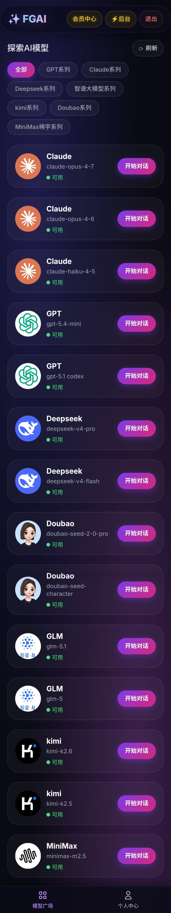

# Ai-chat-transit-platform
Ai模型聚合对话网站，首页可以选择使用的AI模型进行对话，支持上传文件，后台可以添加模型密钥，以及设置会员卡密，拥有独立账号数据记录功能 ; Ai model aggregation dialogue website, the home page can choose the AI model used for dialogue, supports uploading files, can add the model key in the background, and set the membership card secret, and has the function of independent account data recording.
# 
**主页**

在主页，可以直接点击模型进行对话

On the homepage, you can directly click on the model to chat.

